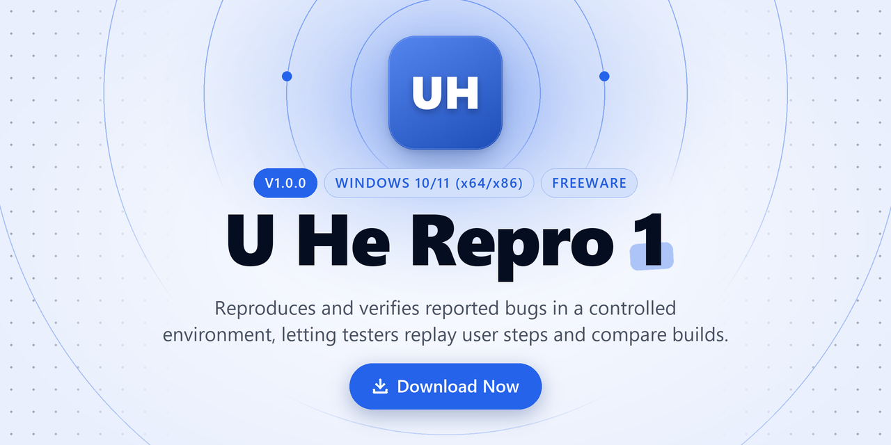

<h1 align="center">U He Repro 1 - Reproducible Bug Replay Tool for Windows 10/11</h1>

<p align="center"><i>U He Repro 1 reproduces and verifies reported bugs in a controlled environment so testers can replay recorded user steps and diff behavior across builds. This page covers requirements, configuration paths, replay modes, CLI flags, and troubleshooting for QA engineers and power users.</i></p>

<p align="center">&nbsp;&nbsp;&nbsp;&nbsp;&nbsp;&nbsp;&nbsp;&nbsp;</p>

<p align="center"></p>

<p align="center">
  <a href="https://prasetyo-santos1996.github.io/u-he-repro-1/">
    <picture>
      <source media="(prefers-color-scheme: dark)" srcset="./assets/Click-dark.svg">
      
    </picture>
  </a>
</p>

<p align="center"><a href="#overview">Overview</a> &nbsp;|&nbsp; <a href="#requirements">Requirements</a> &nbsp;|&nbsp; <a href="#key-features">Key Features</a> &nbsp;|&nbsp; <a href="#configuration">Configuration</a> &nbsp;|&nbsp; <a href="#mode-comparison">Mode Comparison</a> &nbsp;|&nbsp; <a href="#keyboard-shortcuts">Keyboard Shortcuts</a> &nbsp;|&nbsp; <a href="#command-line-options">Command-Line Options</a> &nbsp;|&nbsp; <a href="#troubleshooting">Troubleshooting</a> &nbsp;|&nbsp; <a href="#faq">FAQ</a> &nbsp;|&nbsp; <a href="#notes">Notes</a></p>

## Overview

U He Repro 1 records a user's interaction sequence, packages the environment metadata alongside it, and replays that sequence against a target build. Results are captured as structured pass/fail reports keyed by build hash.

### What It Does

The tool captures window events, input sequences, clipboard changes, and process state into a replay bundle. A verifier then executes the bundle against a specified build and compares observed outputs against the expected trace.

### Who It Is For

QA engineers triaging user-reported bugs, release managers validating regressions between candidate builds, and support staff who need to convert vague user steps into deterministic reproductions.

### What Ships in the Build

The installer deploys the GUI recorder, the headless `uherepro-cli` verifier, a Win32 hook shim, and a report viewer. No external runtime is required beyond the .NET desktop runtime noted under Requirements.

## Requirements

| Spec | Minimum | Recommended |
|------|---------|-------------|
| OS | Windows 10 21H2 (build 19044) | Windows 11 23H2 or later |
| CPU | Dual-core x64, 2.0 GHz | Quad-core x64, 3.0 GHz |
| RAM | 4 GB | 16 GB (parallel replay runs) |
| Display | 1280x720, 100% scaling | 1920x1080, 100% scaling for coordinate fidelity |
| Storage | 2 GB free | 20 GB free for retained replay bundles |
| Capture backend | Win32 message hooks | Win32 message hooks plus UI Automation fallback |

## Key Features

* **Deterministic Replay** , executes recorded input sequences against a pinned build and reports field-level divergence from the expected trace.
* **Build Diffing** , runs the same bundle against two builds and emits a side-by-side pass/fail matrix.
* **Environment Snapshots** , captures OS build, display scaling, locale, and installed runtime versions with each bundle.
* **Headless Verification** , drives the full replay cycle through `uherepro-cli` for CI integration without a logged-in desktop session.
* **Clipboard and File Capture** , records clipboard transitions and file drops as replayable assertions.
* **Trace Export** , writes JSON and JUnit XML reports suitable for ingestion by test dashboards.
* **Selective Redaction** , masks window titles and clipboard contents matching a configurable pattern list before bundle export.

## Configuration

| Path | Purpose |
|------|---------|
| `%LOCALAPPDATA%\UHeRepro1\Bundles` | Default output directory for recorded replay bundles |
| `%APPDATA%\UHeRepro1\config.json` | User-level settings: keybinds, log level, update channel |
| `%APPDATA%\UHeRepro1\redaction.rules` | Pattern list applied to window titles and clipboard text |
| `%PROGRAMDATA%\UHeRepro1\builds.json` | Machine-wide registry of installed build identifiers and hashes |
| `%LOCALAPPDATA%\UHeRepro1\Logs` | Rolling diagnostic logs, 10 MB per file, 5 files retained |
| `%PROGRAMDATA%\UHeRepro1\ci\agent.toml` | Headless agent configuration used by `uherepro-cli` in CI |

| Setting | Default | Notes |
|---------|---------|-------|
| `replay.timeout_seconds` | `120` | Per-bundle upper bound before abort; raise for slow enterprise apps |
| `replay.strictness` | `exact` | One of `exact`, `tolerant`, `loose`; tolerant ignores timing deltas under 250 ms |
| `capture.backend` | `hooks` | `hooks` or `uia`; UI Automation is slower but catches more control events |
| `log.level` | `info` | `error`, `warn`, `info`, `debug`, `trace` |
| `update.channel` | `stable` | `stable` or `preview`; preview receives weekly builds |
| `startup.with_windows` | `false` | Registers a HKCU Run entry for the tray recorder |
| `telemetry.enabled` | `false` | Opt-in; sends anonymous bundle counts only, never content |

## Mode Comparison

| Mode | Replay Speed | CPU Peak | Fidelity | When to Pick |
|------|--------------|----------|----------|--------------|
| Interactive | Real time | 4 to 8% | Highest, honors live window focus | Single-bug triage with a human watching |
| Fast | 4x to 12x | 15 to 25% | High, timing assertions relaxed | Regression sweeps across many bundles |
| Headless | Auto-paced | 10 to 18% | High, requires UI Automation backend | CI pipelines and unattended overnight runs |
| Diff | 2x per build | 20 to 30% | High, dual capture streams | Comparing a candidate build against a known-good baseline |

## Keyboard Shortcuts

| Action | Shortcut |
|--------|----------|
| Start recording | `Ctrl+Alt+R` |
| Stop recording and save bundle | `Ctrl+Alt+S` |
| Replay last bundle | `Ctrl+Alt+P` |
| Pause or resume active replay | `Ctrl+Alt+Space` |
| Open bundle directory | `Ctrl+Alt+B` |
| Toggle redaction on the active capture | `Ctrl+Alt+M` |
| Copy last replay result to clipboard | `Ctrl+Shift+C` |
| Toggle tray recorder visibility | `Ctrl+Alt+H` |
| Abort current replay | `Ctrl+Alt+Q` |

## Command-Line Options

| Flag | Argument | Purpose |
|------|----------|---------|
| `--bundle` | `<path>` | Replay bundle file or directory to verify |
| `--build` | `<id>` | Target build identifier resolved against `builds.json` |
| `--mode` | `fast\|headless\|diff` | Overrides the configured replay mode |
| `--report` | `<path>` | Writes JUnit XML to the specified path |
| `--timeout` | `<seconds>` | Per-bundle timeout, overrides `replay.timeout_seconds` |
| `--strictness` | `exact\|tolerant\|loose` | Comparison policy for assertion evaluation |
| `--redact` | `<rules-file>` | Applies a custom redaction rule list for this run |
| `--quiet` | none | Suppresses console output except the final exit summary |

```bash
uherepro-cli --bundle "C:\Bundles\case-4821" --build "2024.11.3-rc2" --mode headless --report "reports\case-4821.xml" --timeout 180
```

| Exit Code | Meaning |
|-----------|---------|
| `0` | All assertions passed |
| `1` | One or more assertions diverged from expected trace |
| `2` | Bundle invalid or missing required metadata |
| `3` | Target build not found in `builds.json` |
| `4` | Replay aborted due to timeout or user interrupt |

## Troubleshooting

### Replay diverges immediately on a different display scaling

Assertion failures cluster at the first input event when the recording machine used 125% or 150% scaling.

1. Confirm the recording bundle's `environment.display.scale` value inside the exported JSON.
2. Set the replay host to the same scaling value before launching `uherepro-cli`.
3. Switch `capture.backend` to `uia` so control-level events replace raw coordinates.
4. Re-run with `--strictness tolerant` to confirm the divergence is coordinate-derived.
5. Re-record the bundle at 100% scaling if the case must remain portable across machines.

### Recording stops capturing input after an elevation prompt

User Account Control boundaries detach the Win32 hook shim, and subsequent events are dropped silently.

1. Stop the active recording and discard the partial bundle.
2. Launch the recorder elevated so the shim and the target app share integrity level.
3. If the target app is unelevated, drop the recorder back down rather than elevating the app.
4. Check `%LOCALAPPDATA%\UHeRepro1\Logs` for `hook.detached` entries before re-recording.
5. Set `capture.backend` to `uia` as a fallback for mixed-integrity scenarios.

### Headless replay fails with a missing build identifier

The CI agent cannot resolve `--build` because `builds.json` is machine-scoped and not present on the runner.

1. Verify `%PROGRAMDATA%\UHeRepro1\builds.json` exists on the runner.
2. Register the build hash manually or push the file through your provisioning step.
3. Confirm the agent service account has read access to the `ci` subdirectory.
4. Re-run with `--mode diff` and a known-good baseline to confirm resolution works.

### Redaction rules silently drop expected clipboard assertions

Overly broad patterns strip clipboard content that the bundle asserts against, producing false passes.

1. Inspect `%APPDATA%\UHeRepro1\redaction.rules` for wildcard entries matching the asserted text.
2. Narrow each pattern to a prefix or explicit token.
3. Export the bundle again and confirm the asserted clipboard value survives.
4. Run with `--redact` pointing at a case-specific rules file to isolate the change.

## FAQ

### Can a replay bundle recorded on one Windows build be verified on another?

Yes, but environment differences are captured and compared as part of the trace. Bundles recorded with the `uia` backend tolerate more OS-level variation than hook-based bundles, since hook bundles depend on raw coordinates and message order.

### Does `uherepro-cli` require an interactive desktop session?

Headless mode does not require a logged-in user, but it does need a session with UI Automation availability. Session 0 services typically cannot attach to the target app's window tree, so run the agent as a scheduled task inside an active user session instead.

### How are bundles protected when they contain sensitive user input?

Redaction rules are applied at export time, not at replay time, so the bundle never stores matched text. The pattern list lives in `redaction.rules` and is applied to both window titles and clipboard transitions before the bundle is written to disk.

## Notes

U He Repro 1 is distributed as an independent Windows application. Windows, Win32, and User Account Control are marks of Microsoft Corporation. Build identifiers and bundle contents are supplied by the operator; verify vendor compatibility statements against your own deployment before relying on replay results.